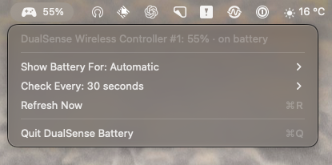

# DualSense Battery

A small native macOS menu-bar app for checking controller battery levels. Built with Swift, AppKit, and Apple's GameController framework, with no third-party dependencies.



## Features

- Battery percentage beside a controller icon in the menu bar.
- Charging indicator and per-controller details in the dropdown.
- Select an individual controller, prefer a DualSense automatically, or show the lowest reported battery level.
- Numbered labels for controllers with identical names.
- Configurable checking intervals: 5, 10, or 30 seconds; 1 or 5 minutes.
- Saved interval and display-mode preferences.
- Refresh Now is disabled when no controllers are connected.
- Runs without a Dock icon; can be added to macOS login items.

## Requirements

- macOS 13 or later.
- Xcode Command Line Tools or Xcode with the Swift compiler and macOS SDK.
- A connected controller supported by Apple's GameController framework.

Live battery reporting has been checked with a PS5 DualSense over Bluetooth on Apple silicon. Other controllers depend on the battery information macOS exposes and have not been hardware-tested. Multi-controller selection is covered by simulated tests.

## Build and run

```sh
git clone https://github.com/farzadso/dualsense-battery.git
cd dualsense-battery
./scripts/build.sh
open "build/DualSense Battery.app"
```

The build targets your current Mac's architecture and creates an ad-hoc signed app. It is not Developer ID signed or notarized.

## Install

Quit any running copy using the menu-bar app's Quit command, then:

```sh
mkdir -p "$HOME/Applications"
ditto "build/DualSense Battery.app" "$HOME/Applications/DualSense Battery.app"
open "$HOME/Applications/DualSense Battery.app"
```

To start automatically, add the installed app to **System Settings → General → Login Items → Open at Login** (the settings label may include “Extensions” on some macOS versions).

## Use

Click the controller icon to open the menu:

- **Show Battery For → Automatic:** prefers a DualSense, otherwise selects the first available controller.
- **Show Battery For → Lowest Battery:** displays the lowest known level, including charging controllers. Unavailable readings are ignored.
- **Show Battery For → a controller:** displays that controller's level. If it disconnects, the menu bar shows a dash instead of silently switching devices.
- **Check Every:** changes the periodic refresh interval. Connection changes also trigger a refresh.
- **Refresh Now:** requests an immediate reading from the framework.

The framework exposes battery estimates; refreshing faster does not guarantee a new hardware reading.

### Controller identity

The API used here does not expose a stable physical-device identifier. Numbers distinguish controllers within an app session; they are not permanent device IDs. Reselect an individual controller after it reconnects or after the app restarts. Automatic and Lowest Battery modes persist across restarts.

### Privacy

The app makes no network requests and does not require a GitHub account. Settings are stored locally with UserDefaults. It reads controller connection and battery information without changing controller mappings, lights, or vibration.

## Development

```sh
./scripts/test.sh
./scripts/build.sh
"build/DualSense Battery.app/Contents/MacOS/DualSenseBattery" --check
```

`--check` waits five seconds for controller discovery, prints battery readings and current preferences as JSON, then exits. Run it in a normal desktop session; a sandbox may hide connected controllers.

Tests cover explicit selection, identical names, disconnections, lowest-battery changes, charging controllers, unknown levels, an empty list, and a zero-percent battery.

Source files are in `Sources/`; the app bundle metadata is in `Resources/Info.plist`. Build products and compiler caches stay in the ignored `build/` directory.

This is an independent project, not affiliated with Sony or Apple.

## License

[MIT](LICENSE) © 2026 Farzad Soltani.
